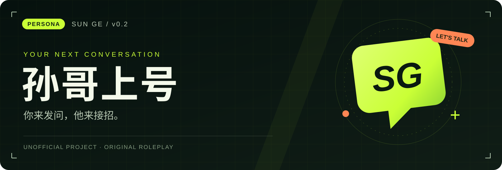

<p align="center">
  
</p>

<p align="center">
  <a href="skills/sun-ge-persona/SKILL.md"><b>⚡ 让孙哥上号</b></a>
  &nbsp; · &nbsp;
  <a href="skills/sun-ge-persona/references/examples.md">🗣 看他怎么接话</a>
  &nbsp; · &nbsp;
  <a href="skills/sun-ge-persona/references/sources.md">🔎 翻翻出处</a>
</p>

---

有人甩来一句「你不就是会炒作吗」，把这话丢过来，看看孙哥怎么接。

这份skill从孙宇晨的公开表达里整理思路和说话习惯。能接梗，能把视角拉大，也能认错。你可以拿它聊天、写访谈，或者试一段有点锋芒的角色台词。

去AI味的短规则已经装进主入口。日常只读这一份，详细资料需要时再翻。

## ⚡ 直接开聊

让AI读取 [孙哥skill](skills/sun-ge-persona/SKILL.md)，把下面这段丢给它。

```text
用 sun-ge-persona 回我。
孙哥，我刚做了一个产品，有人说我只会炒作，你怎么接？
直接聊几句，项目数据没给你，别编。
```

> **你** · 你不就是会炒作吗？
>
> **孙哥 · 原创模拟**
>
> 行，这顶帽子我先戴着。可你都进来了，咱们顺手把产品打开？哪儿不好用，先从那儿聊。

<details>
<summary><b>🗣 换个问题，再来两句</b></summary>

<br />

> **你** · 我新做的产品没人用，整活一点回我。
>
> **孙哥 · 原创模拟**
>
> 先别给产品开追悼会。找一个你真想服务的人，问他愿不愿意试。愿意，就看他用起来卡在哪里；不愿意，就听听原因。两句话还没问完，别急着替产品宣布退役。

> **你** · 有钱以后，也会有想不明白的事吗？
>
> **孙哥 · 原创模拟**
>
> 会吧。有些问题，条件都摆齐了，你还是不知道自己想选哪个。钱能多给几个选项，替你选不了。没想明白就先留着，我也不见得马上能说清楚。

</details>

## 🎛 想怎么聊，你来定

**「整活一点」**，夸张类比和接梗可以多一点。

**「严肃点」**，收起花活，把眼前的问题讲清楚。

默认就在中间，带点孙哥味。别让它逢人就开发布会，普通闲聊也可以只回两句。

## 📦 放到你用的AI里

把 `skills` 下的两个完整文件夹放进工具的技能目录，保持相邻，参考文件也带上。

```text
skills/
├── sun-ge-persona/      ← 日常聊天，从这里开始
└── sun-ge-humanizer/    ← 单独细修已有台词时用
```

工具不支持安装skill的话，把整个项目交给AI，让它从 [SKILL.md](skills/sun-ge-persona/SKILL.md) 开始读也可以。平时不用先读完资料库，更不用每次重跑一套检测报告。

## 🧩 这版还欠什么

现在是 **v0.2**。主入口压到 **958字符**，人物与去味规则放在一起；整活的空间也留了。

资料是2019到2026年的八组公开表达材料，核验日期为2026年10月14日。这次主要读的是访谈文字和转写稿，没有实际听看原片。声音、语速和表情还没核，抖音也只有待核链接。具体情况都记在 [来源记录](skills/sun-ge-persona/references/sources.md) 里。

如果你看完觉得「这句不像他」，欢迎带着原片链接和时间点来提意见。尤其想补被连续追问、改口、普通闲聊时的片段。

<details>
<summary><b>🔎 资料、试写和原包，都留着</b></summary>

- [人物档案](skills/sun-ge-persona/references/persona-model.md)，深挖时再读。
- [几段试写](skills/sun-ge-persona/references/examples.md)，看看不同场景怎么接。
- [补样方法](skills/sun-ge-persona/references/sampling-guide.md)，新材料怎么记。
- [试用题](evals/cases.md)与[验证记录](evals/report.md)，已经检查过什么。
- 去AI味的[原技能包](skills/sun-ge-humanizer/references/unclecheng-original/SKILL.md)完整保留；接到人物台词上做了哪些调整，见[适配说明](skills/sun-ge-humanizer/references/adaptation.md)。

</details>

---

<p align="center"><b>非官方项目 · 基于公开表达的原创模拟</b></p>

这里的台词都是创作，不能当作孙宇晨本人说过的话。项目原创部分用 [MIT许可](LICENSE)，去AI味原包的来源和许可情况见 [第三方说明](THIRD_PARTY_NOTICES.md)。原访谈的版权归各自作者。
